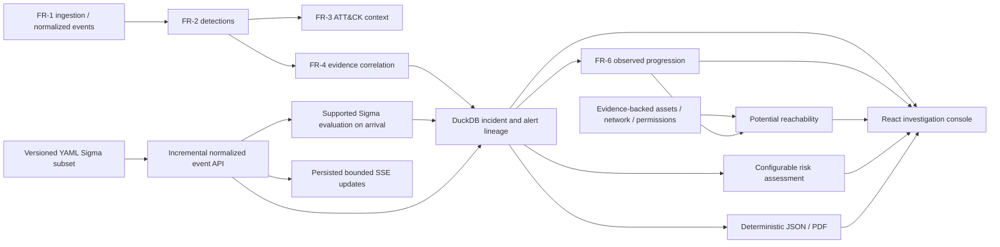

# KILLCHAIN AI Architecture: FR-6 and FR-7

## Evidence flow

## Dataset library and analysis lifecycle

- The existing FR-1 checkpoint SQLite file also stores the persistent dataset
  registry, upload receipts, active dataset, independent analysis runs, and
  deletion/validation audit history.
- Upload chunks are written to dataset-specific temporary paths, flushed and
  atomically renamed after size/hash acknowledgement. Final assembly is
  streamed and checked against total size and SHA-256 before the source becomes
  selectable.
- Dataset event identifiers are deterministic and namespaced by dataset ID.
  `normalized_events` and `structured_events` carry a nullable `dataset_id`;
  schema initialization adds these columns to existing DuckDB databases.
  FR-2 detector queries accept a dataset scope so unrelated library records do
  not affect a dataset's detection results.
- Dataset analysis uses the existing bounded FR-1 workers and chunk
  checkpoints, then FR-2 detection/fusion and FR-3 mapping. Progress is
  record-based when validation supplies a count and reaches 100% only after
  these implemented stages succeed.
- FR-4 correlation, FR-5 attack-path reconstruction, and FR-6 reachability
  are not automatically launched from dataset analysis. Their evidence APIs
  remain independently available.
- Existing local datasets are registered by canonical path and analyzed in
  place. Local directory registration is bounded to 500 supported files and
  creates one dataset record per file. Access is restricted to configured
  `KILLCHAIN_LOCAL_DATA_ROOTS` (default: project `data`); local registration
  never copies or deletes source content.
- Upload pause and analysis cancellation are not supported. Upload resume
  requires reselecting the original file. At most two analysis workers run,
  with four admitted jobs.

## Data and trust boundaries

- DuckDB stores normalized and structured events, detections, incident
  snapshots, raw alert lineage, asset inventory, directional topology,
  permissions, Sigma audit/version records, live processing status/checkpoints,
  and a bounded SSE replay log.
- Network relationships and permission grants require source evidence
  references. Reachability considers only the supported network relationship
  types and explicitly supplied permissions.
- Observed progression is computed from stored incident events and
  evidence-backed event relationships. `confirmed_compromised` is only emitted
  when an explicit asset confirmation includes evidence references; login and
  connection events are insufficient.
- Potential reachability is separate from observed attacker movement. ATT&CK
  mappings provide context and do not create topology or event edges.
- Risk is a weighted evidence prioritization aid, configured in
  `config/risk_weights.yaml`; scores are not probabilities.
- Reports serialize stored evidence and limitations. They do not call an AI
  service or create synthetic narrative facts.
- Live event input is normalized JSON. It is not a raw log tailer or a general
  purpose message broker. Batch size is capped at 500, candidate correlation
  results at 500 events, and SSE replay at 10,000 updates.
- The browser's EventSource reconnects with event IDs. A client older than the
  replay window receives `stream_reset` and must refresh its API snapshot.
- Failed or interrupted live events retain a retry payload. Successful
  records retain a payload hash, and `POST /api/v1/live/recover` retries
  recoverable rows explicitly.

## Rule lifecycle

`config/sigma_rules.yaml` is the authoritative active rule document. CRUD
operations validate the supported subset before atomically replacing the YAML
file. Version numbers and an audit record are stored in DuckDB. Rules outside
the exact single-selector subset are listed as unsupported and are not run.

## Runtime limitations

- The FastAPI service currently has no authentication or authorization. Asset
  confirmation actor labels are explicitly unauthenticated.
- Event/incident job registries and graph caches are process-local. Durable
  events, alert records, incident snapshots, checkpoints, and SSE updates are
  in DuckDB; recovery is exposed explicitly for interrupted live events.
- Large stored incident snapshots still contain serialized evidence. Very
  large incidents and high-frequency live loads require deployment-specific
  database and memory benchmarks.
- The official evaluation dataset and production topology/permission feeds
  were not provided. Current acceptance tests use clearly labeled synthetic
  records.
- Sarvam integration and credentials were not used or modified.
